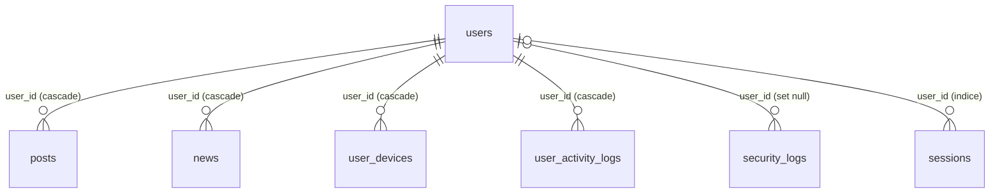

# Base de Datos

Documentación técnica de la capa de datos de EduNivelam. Volver al [índice de documentación](../README.md).

---

## 1. Estado Actual

**Implementado y en funcionamiento.** El esquema se construye íntegramente con migraciones de Laravel y se accede mediante Eloquent ORM y Query Builder.

| Característica | Valor |
|---|---|
| Framework | Laravel 13 (`laravel/framework ^13.0`) |
| Motor de base de datos del proyecto | MySQL |
| Conexión por defecto en `.env.example` | `sqlite` |
| Conexiones disponibles en `config/database.php` | `sqlite`, `mysql`, `mariadb`, `pgsql`, `sqlsrv` |
| Codificación y cotejamiento (MySQL) | `utf8mb4` / `utf8mb4_unicode_ci` |
| Migraciones | 21 archivos |
| Tablas | 15 tablas de aplicación y framework, más la tabla `migrations` |
| Modelos Eloquent | 5 (`User`, `News`, `Banner`, `Post`, `ReceivedEmail`) |
| Seeders / Factories | `DatabaseSeeder` (un usuario de prueba) y `UserFactory` |
| Drivers que usan la base de datos | Sesiones (`SESSION_DRIVER=database`), caché (`CACHE_STORE=database`) y cola (`QUEUE_CONNECTION=database`) |

Resumen de las tablas:

| Grupo | Tablas |
|---|---|
| Usuarios y acceso | `users`, `password_reset_tokens`, `sessions`, `security_logs`, `user_devices`, `user_activity_logs` |
| Contenido del sitio | `news`, `banners`, `posts` |
| Comunicaciones | `received_emails` |
| Infraestructura del framework | `cache`, `cache_locks`, `jobs`, `job_batches`, `failed_jobs`, `migrations` |

---

## 2. Propósito del Componente

Almacenar de forma persistente y estructurada toda la información de la plataforma:

| Necesidad | Tablas que la resuelven |
|---|---|
| Identidad, roles, aprobación de docentes y preferencias de cada usuario | `users` |
| Mantener sesiones activas, control de intentos y trazabilidad de accesos | `sessions`, `cache`, `security_logs`, `user_activity_logs`, `user_devices` |
| Publicar noticias y textos editables del sitio público | `news`, `banners` |
| Centralizar los correos de contacto recibidos por IMAP | `received_emails` |
| Soporte de colas y bloqueos del framework | `jobs`, `job_batches`, `failed_jobs`, `cache_locks` |

Roles que interactúan con los datos:

| Rol | Interacción |
|---|---|
| Administrador | Gestiona usuarios, noticias, banners y correos; genera respaldos SQL y ejecuta el mantenimiento de la base de datos. |
| Docente | Su registro se almacena en `users` con estado pendiente hasta la aprobación. |
| Estudiante | Su cuenta, preferencias y registro de actividad se almacenan en `users` y `user_activity_logs`. |

---

## 3. Estructura Interna

### 3.1 Configuración de la conexión

Archivo: `config/database.php`. La conexión se elige con la variable `DB_CONNECTION`.

| Variable | Uso |
|---|---|
| `DB_CONNECTION` | Conexión activa (`mysql` en el proyecto; `sqlite` por defecto en `.env.example`). |
| `DB_HOST`, `DB_PORT` | Servidor y puerto (3306 para MySQL). |
| `DB_DATABASE`, `DB_USERNAME`, `DB_PASSWORD` | Base de datos y credenciales. |
| `DB_CHARSET`, `DB_COLLATION` | Codificación y cotejamiento (`utf8mb4`, `utf8mb4_unicode_ci`). |
| `SESSION_DRIVER` | `database`: las sesiones se guardan en la tabla `sessions`. |
| `CACHE_STORE` | `database`: la caché se guarda en `cache` y `cache_locks`. |
| `QUEUE_CONNECTION` | `database`: las colas usan `jobs`, `job_batches` y `failed_jobs`. |
| `BANNERS_DISK` | Disco de almacenamiento de las imágenes de banners (`public` por defecto). |

El `Dockerfile` instala la extensión `pdo_mysql` sobre `php:8.3-apache`. La conexión `sqlsrv` está definida en la configuración, pero requiere la extensión correspondiente en el servidor donde se use.

### 3.2 Migraciones (`database/migrations/`)

Se ejecutan en orden cronológico por nombre de archivo.

| Archivo | Acción |
|---|---|
| `0001_01_01_000000_create_users_table` | Crea `users`, `password_reset_tokens` y `sessions`. |
| `0001_01_01_000001_create_cache_table` | Crea `cache` y `cache_locks`. |
| `0001_01_01_000002_create_jobs_table` | Crea `jobs`, `job_batches` y `failed_jobs`. |
| `2026_08_27_230321_create_posts_table` | Crea `posts`. |
| `2026_09_18_132219_create_received_emails_table` | Crea `received_emails`. |
| `2026_09_26_231024_add_is_active_to_users_table` | Agrega `is_active` a `users`. |
| `2026_09_26_235741_create_security_logs_table` | Crea `security_logs`. |
| `2026_09_27_222411_add_role_and_approval_to_users_table` | Agrega `role` e `is_approved`. |
| `2026_09_27_223810_add_teacher_details_to_users_table` | Agrega `dni`, `country_code`, `phone`, `birthdate`, `teaching_type`. |
| `2026_09_29_214505_add_avatar_and_bio_to_users_table` | Agrega `avatar` y `bio`. |
| `2026_09_29_215617_add_appearance_preferences_to_users_table` | Agrega `font_size` y `high_contrast`. |
| `2026_09_29_224536_create_user_sessions_and_activity_logs_table` | Crea `user_devices` y `user_activity_logs`. |
| `2026_09_30_163716_add_locale_to_users_table` | Agrega `locale`. |
| `2026_10_07_223251_create_news_table` | Crea `news`. |
| `2026_10_07_225649_add_fields_to_news_table` | Agrega `category`, `excerpt`, `image` a `news`. |
| `2026_10_08_221426_create_banners_table` | Crea `banners`. |
| `2026_10_09_223413_add_dynamic_fields_to_banners_table` | Agrega `badge_text` y `content_text`. |
| `2026_10_11_233047_add_social_links_to_users_table` | Agrega `github_url`, `linkedin_url`, `portfolio_url`. |
| `2026_10_14_155807_add_original_avatar_to_users_table` | Agrega `original_avatar`. |
| `2026_10_14_161922_add_scheduled_at_to_news_table` | Agrega `scheduled_at` a `news`. |
| `2026_10_28_154626_add_google_id_to_users_table` | Agrega `google_id` (único). |

Las migraciones que añaden columnas a `users` para `role`, `is_approved` y los datos de docente comprueban con `Schema::hasColumn` antes de crear cada campo, por lo que pueden ejecutarse sobre una base de datos ya existente sin error por duplicidad.

### 3.3 Modelos (`app/Models/`)

| Modelo | Tabla | Atributos asignables (`$fillable`) | Casts y accesores | Relaciones |
|---|---|---|---|---|
| `User` | `users` | `name`, `email`, `password`, `dni`, `country_code`, `phone`, `birthdate`, `teaching_type`, `role`, `is_approved`, `is_active`, `avatar`, `bio`, `font_size`, `high_contrast`, `github_url`, `linkedin_url`, `portfolio_url` | `email_verified_at` datetime, `password` hashed, `is_active` boolean, `is_approved` boolean. Atributos ocultos: `password`, `remember_token`. Implementa `MustVerifyEmail`. Constante `ROLES`. | Ninguna declarada. |
| `News` | `news` | `title`, `category`, `excerpt`, `content`, `image`, `status`, `scheduled_at`, `user_id` | Ninguno. | `user()`: pertenece a `User`. |
| `Banner` | `banners` | `page_identifier`, `title`, `subtitle`, `badge_text`, `content_text`, `image_path`, `is_active` | `is_active` boolean. Accesor `image_url` (URL pública de la imagen). Constante `PAGES` con las páginas editables y sus campos. | Ninguna. |
| `Post` | `posts` | `user_id`, `title`, `content` | Ninguno. | `user()`: pertenece a `User`. |
| `ReceivedEmail` | `received_emails` | `message_id`, `from_email`, `from_name`, `subject`, `body`, `received_at`, `is_read` | `received_at` datetime, `is_read` boolean. Accesor `display_message` (texto limpio del cuerpo HTML). | Ninguna. |

Observaciones sobre `User`:

- Los campos `google_id`, `locale`, `reset_code` y `reset_code_expires_at` no están en `$fillable`. El código los asigna directamente sobre la instancia cuando corresponde (`google_id`, `reset_code`, `reset_code_expires_at`). En el caso de `locale`, el valor `es` que se envía en `User::create` no se persiste, y se conserva el valor por defecto definido en la migración (`es_MX`).
- El rol `role` es un `string`; los valores permitidos se definen en la constante `User::ROLES` (`admin`, `teacher`, `student`, `user`).

### 3.4 Tablas sin modelo

Estas tablas se manejan con `DB::table()` (Query Builder):

| Tabla | Utilizada por |
|---|---|
| `security_logs` | `AuthController`, `GoogleAuthController` (inserción) y `DashboardController` (consulta). |
| `user_activity_logs` | `SettingsController` (inserción mediante `logActivity` y consulta de las últimas 10 acciones del usuario). |
| `user_devices` | `SettingsController::index` (consulta de dispositivos del usuario, ordenados por última actividad). |
| `sessions`, `cache`, `cache_locks`, `jobs`, `job_batches`, `failed_jobs`, `password_reset_tokens` | Gestionadas internamente por Laravel. |

### 3.5 Seeders y factories

| Archivo | Contenido |
|---|---|
| `database/seeders/DatabaseSeeder.php` | Crea un usuario de prueba: `Test User` / `test@example.com`. |
| `database/factories/UserFactory.php` | Genera `name`, `email` único, `email_verified_at` actual, contraseña `password` (hash) y `remember_token`. |

### 3.6 Archivos asociados a la base de datos

Las imágenes no se almacenan en la base de datos; se guardan en el disco de archivos y la tabla conserva solamente la ruta:

| Campo | Contenido |
|---|---|
| `users.avatar`, `users.original_avatar` | Ruta de la foto de perfil y de la imagen original sin recorte. |
| `news.image` | Ruta de la imagen de la noticia. |
| `banners.image_path` | Ruta de la imagen del banner (disco definido en `config/banners.php`, directorio `banners`). |

---

## 4. Flujo de Funcionamiento

### 4.1 Creación del esquema

1. Configurar `DB_CONNECTION=mysql` y las demás variables `DB_*` en el archivo `.env`.
2. Ejecutar las migraciones: `php artisan migrate`. Laravel registra los archivos aplicados en la tabla `migrations`.
3. Opcionalmente, cargar los datos iniciales: `php artisan db:seed`.
4. Para revertir el último lote: `php artisan migrate:rollback`.

### 4.2 Acceso a los datos

1. Las peticiones llegan a los controladores a través de `routes/web.php`.
2. Los controladores acceden a los datos mediante Eloquent (`User`, `News`, `Banner`, `Post`, `ReceivedEmail`) o mediante `DB::table()` en las tablas sin modelo.
3. Las validaciones previas a la escritura se realizan en el controlador (reglas `unique`, `regex`, `in`, entre otras). Las restricciones únicas de la base de datos actúan como segunda barrera de integridad.

### 4.3 Ciclo de vida de los datos

| Dato | Creación | Eliminación o cambio |
|---|---|---|
| Cuentas de estudiante sin verificar | Al registrarse. | Se eliminan al cerrar sesión sin haber verificado el correo, y cuando alguien se registra de nuevo con el mismo correo o documento. |
| Solicitudes de docente | Se crean con `is_approved = 0` e `is_active = 0`. | La aprobación activa la cuenta; el rechazo elimina el registro. |
| Eventos de acceso (`security_logs`) | En cada login exitoso, fallido o con cuenta inactiva. | Se conservan; el campo `user_id` pasa a nulo si el usuario se elimina. |
| Intentos y bloqueos de login | En caché (`cache`), con expiración automática. | Expiran solos (hasta 24 horas). |
| Correos recibidos (`received_emails`) | El comando `mail:receive` los sincroniza por IMAP, evitando duplicados mediante `message_id`. | El mismo comando elimina los que superan 7 días de antigüedad. |
| Noticias programadas | Se guardan con `status = programado` y `scheduled_at`. | Al vencer la fecha pasan a `publicado` y `scheduled_at` queda en nulo. |
| Sesiones | Una fila por sesión activa en `sessions`. | Se eliminan al cerrar sesión o por expiración. |

### 4.4 Eliminación en cascada

Al eliminar un usuario de `users`, la base de datos aplica las siguientes reglas de integridad referencial:

| Tabla dependiente | Regla |
|---|---|
| `posts` | Elimina en cascada las publicaciones del usuario. |
| `news` | Elimina en cascada las noticias creadas por el usuario. |
| `user_devices` | Elimina en cascada los dispositivos. |
| `user_activity_logs` | Elimina en cascada el historial de actividad. |
| `security_logs` | Conserva los registros y establece `user_id` en nulo. |

### 4.5 Respaldo de la base de datos

1. El administrador ejecuta la acción de respaldo desde el panel de configuración del sistema.
2. `SettingsController::generateBackup` valida que el usuario tenga rol `admin`.
3. Recorre las tablas obtenidas con `Schema::getTables()`, omitiendo `migrations`, `sqlite_sequence` e `historias`.
4. Por cada tabla lee todos los registros y genera sentencias `INSERT` con nombres de columnas entre acentos graves y valores escapados.
5. Entrega el resultado como descarga de un archivo `backup_edunivelam_completo_AAAA-MM-DD_HH-MM-SS.sql`, con encabezado que indica base de datos, driver, fecha y administrador.

El respaldo contiene únicamente los datos (sentencias `INSERT`); la estructura se recrea con las migraciones.

### 4.6 Mantenimiento y optimización

1. El administrador ejecuta la optimización desde el panel de configuración del sistema.
2. `SettingsController::optimizeDatabase` valida el rol `admin` y obtiene el driver activo.
3. Si el driver es `mysql`, ejecuta `OPTIMIZE TABLE` sobre cada tabla y cuenta las procesadas; con otros drivers solo reporta el conteo de tablas.
4. Devuelve un informe con tablas procesadas, driver y estado, y registra la acción en `user_activity_logs`.

### 4.7 Exportación de datos personales

Cada usuario autenticado puede descargar sus propios datos desde Configuración (`GET /settings/download-data`), entregados como archivo JSON mediante `streamDownload`.

---

## 5. Rutas y Permisos

### 5.1 Rutas que operan directamente sobre la base de datos

| Método | URI | Nombre | Controlador | Middleware | Acción |
|---|---|---|---|---|---|
| POST | `/admin/system/backup` | `admin.system.backup` | `SettingsController@generateBackup` | `can:manage-users` (más `authorizeAdmin()` en el controlador) | Genera y descarga el respaldo `.sql`. |
| POST | `/admin/system/db/optimize` | `admin.system.db.optimize` | `SettingsController@optimizeDatabase` | `can:manage-users` (más `authorizeAdmin()`) | Optimiza las tablas. |
| GET | `/settings/download-data` | `settings.data.download` | `SettingsController@downloadPersonalData` | Grupo `auth` | Descarga los datos personales del usuario. |
| GET | `/admin/security` | `admin.security` | `DashboardController@security` | `auth`, `verified`, `can:manage-users` | Consulta `security_logs`. |

### 5.2 Rutas por tabla de contenido

| Tabla | Rutas principales | Middleware |
|---|---|---|
| `users` | Rutas de autenticación (ver [`autenticacion.md`](./autenticacion.md)) y `admin/users`, `admin/teachers/*` | Según el módulo; las de administración requieren sesión verificada. |
| `news` | `admin/news` (alta, edición, eliminación) y `/news` (consulta pública) | Administración con `can:manage-users`. |
| `banners` | `admin/banners` (recurso) | `can:manage-users` |
| `received_emails` | `admin/correos/*` | `auth`, `verified` |
| `posts` | `Route::resource('posts')` | Sin middleware de grupo declarado en la ruta. |

### 5.3 Comandos Artisan relacionados

| Comando | Función |
|---|---|
| `php artisan migrate` | Aplica las migraciones pendientes. |
| `php artisan migrate:rollback` | Revierte el último lote. |
| `php artisan migrate:fresh --seed` | Recrea todo el esquema y carga los datos iniciales (solo en desarrollo). |
| `php artisan db:seed` | Ejecuta `DatabaseSeeder`. |
| `php artisan mail:receive` | Sincroniza `received_emails` y purga registros de más de 7 días. |
| `php artisan news:publish-scheduled` | Publica las noticias programadas cuyo `scheduled_at` ya venció. |

### 5.4 Permisos

| Operación | Rol requerido |
|---|---|
| Generar respaldo y optimizar la base de datos | `admin` |
| Consultar `security_logs` | `admin` |
| Gestionar usuarios, noticias, banners y correos | `admin` |
| Descargar datos personales | Cualquier usuario autenticado, solo los propios |
| Acceso directo a la base de datos | Solo mediante las credenciales `DB_*` del servidor |

---

## 6. Datos

### 6.1 Diagrama de relaciones

Las tablas `banners`, `received_emails`, `password_reset_tokens`, `cache`, `cache_locks`, `jobs`, `job_batches` y `failed_jobs` no tienen relaciones con otras tablas.

### 6.2 Tabla `users`

| Campo | Tipo | Nulo | Por defecto | Restricción | Descripción |
|---|---|---|---|---|---|
| `id` | bigint unsigned | No | Autoincremental | Clave primaria | Identificador. |
| `name` | varchar(255) | No | | | Nombre completo. |
| `email` | varchar(255) | No | | Único | Correo, en minúsculas. |
| `google_id` | varchar(255) | Sí | | Único | Identificador de Google vinculado. |
| `locale` | varchar(255) | No | `es_MX` | | Idioma del usuario. |
| `avatar` | varchar(255) | Sí | | | Ruta de la foto de perfil. |
| `original_avatar` | varchar(255) | Sí | | | Ruta de la imagen original. |
| `bio` | text | Sí | | | Biografía. |
| `dni` | varchar(255) | Sí | | Único | Documento de identidad. |
| `country_code` | varchar(255) | Sí | | | Prefijo telefónico. |
| `phone` | varchar(255) | Sí | | Único | Teléfono. |
| `birthdate` | date | Sí | | | Fecha de nacimiento. |
| `teaching_type` | varchar(255) | Sí | | | `courses` o `advisories`. |
| `email_verified_at` | timestamp | Sí | | | Fecha de verificación del correo. |
| `password` | varchar(255) | No | | | Hash de la contraseña. |
| `role` | varchar(255) | No | `student` | | `admin`, `teacher`, `student` o `user`. |
| `is_approved` | boolean | No | `true` | | Aprobación (docentes). |
| `is_active` | boolean | No | `true` | | Cuenta habilitada. |
| `font_size` | varchar(20) | No | `14px` | | Tamaño de fuente preferido. |
| `high_contrast` | boolean | No | `false` | | Preferencia de alto contraste. |
| `github_url` | varchar(255) | Sí | | | Enlace social. |
| `linkedin_url` | varchar(255) | Sí | | | Enlace social. |
| `portfolio_url` | varchar(255) | Sí | | | Enlace social. |
| `reset_code` | varchar(255) | Sí | | | Código de recuperación de contraseña. |
| `reset_code_expires_at` | timestamp | Sí | | | Vencimiento del código. |
| `remember_token` | varchar(100) | Sí | | | Token de "recordarme". |
| `created_at`, `updated_at` | timestamp | Sí | | | Marcas de tiempo. |

### 6.3 Tablas de acceso y seguridad

**`password_reset_tokens`** (creada por la migración base de Laravel)

| Campo | Tipo | Restricción |
|---|---|---|
| `email` | varchar(255) | Clave primaria |
| `token` | varchar(255) | |
| `created_at` | timestamp, nulo | |

**`sessions`**

| Campo | Tipo | Restricción |
|---|---|---|
| `id` | varchar(255) | Clave primaria |
| `user_id` | bigint unsigned, nulo | Índice |
| `ip_address` | varchar(45), nulo | |
| `user_agent` | text, nulo | |
| `payload` | longtext | |
| `last_activity` | int | Índice |

**`security_logs`**

| Campo | Tipo | Restricción |
|---|---|---|
| `id` | bigint unsigned | Clave primaria |
| `user_id` | bigint unsigned, nulo | Clave foránea a `users.id`, `ON DELETE SET NULL` |
| `email` | varchar(255), nulo | |
| `ip_address` | varchar(255), nulo | |
| `status` | varchar(255) | `success` o `failed` |
| `event_type` | varchar(255) | `successful_login`, `failed_login`, `inactive_account_access` |
| `description` | text | |
| `user_agent` | text, nulo | |
| `created_at`, `updated_at` | timestamp, nulo | Índice compuesto (`created_at`, `ip_address`) |

**`user_devices`**

| Campo | Tipo | Restricción |
|---|---|---|
| `id` | bigint unsigned | Clave primaria |
| `user_id` | bigint unsigned | Clave foránea a `users.id`, `ON DELETE CASCADE` |
| `ip_address` | varchar(45) | |
| `user_agent` | text | |
| `last_active_at` | timestamp | |
| `created_at`, `updated_at` | timestamp, nulo | |

**`user_activity_logs`**

| Campo | Tipo | Restricción |
|---|---|---|
| `id` | bigint unsigned | Clave primaria |
| `user_id` | bigint unsigned | Clave foránea a `users.id`, `ON DELETE CASCADE` |
| `action` | varchar(255) | Descripción de la acción realizada |
| `ip_address` | varchar(45) | |
| `created_at`, `updated_at` | timestamp, nulo | |

### 6.4 Tablas de contenido

**`news`**

| Campo | Tipo | Nulo | Por defecto | Restricción |
|---|---|---|---|---|
| `id` | bigint unsigned | No | Autoincremental | Clave primaria |
| `title` | varchar(255) | No | | |
| `content` | text | No | | |
| `category` | varchar(255) | No | `General` | |
| `excerpt` | text | Sí | | |
| `image` | varchar(255) | Sí | | |
| `status` | varchar(255) | No | `publicado` | Valores usados: `publicado`, `borrador`, `programado` |
| `scheduled_at` | datetime | Sí | | Fecha de publicación programada |
| `user_id` | bigint unsigned | No | | Clave foránea a `users.id`, `ON DELETE CASCADE` |
| `created_at`, `updated_at` | timestamp | Sí | | |

**`banners`**

| Campo | Tipo | Nulo | Por defecto | Restricción |
|---|---|---|---|---|
| `id` | bigint unsigned | No | Autoincremental | Clave primaria |
| `page_identifier` | varchar(255) | No | | Único. Valores permitidos: `home`, `about`, `news`, `courses`, `instructors`, `contact` |
| `title` | varchar(255) | No | | |
| `subtitle` | text | Sí | | |
| `badge_text` | varchar(255) | Sí | | |
| `content_text` | text | Sí | | |
| `image_path` | varchar(255) | Sí | | |
| `is_active` | boolean | No | `true` | |
| `created_at`, `updated_at` | timestamp | Sí | | |

**`posts`**

| Campo | Tipo | Restricción |
|---|---|---|
| `id` | bigint unsigned | Clave primaria |
| `user_id` | bigint unsigned | Clave foránea a `users.id`, `ON DELETE CASCADE` |
| `title` | varchar(255) | |
| `content` | text | |
| `created_at`, `updated_at` | timestamp, nulo | |

**`received_emails`**

| Campo | Tipo | Nulo | Por defecto | Restricción |
|---|---|---|---|---|
| `id` | bigint unsigned | No | Autoincremental | Clave primaria |
| `message_id` | varchar(255) | No | | Único (evita duplicados al sincronizar) |
| `from_email` | varchar(255) | No | | |
| `from_name` | varchar(255) | Sí | | |
| `subject` | varchar(255) | Sí | | |
| `body` | longtext | Sí | | |
| `received_at` | timestamp | Sí | | |
| `is_read` | boolean | No | `false` | |
| `created_at`, `updated_at` | timestamp | Sí | | |

### 6.5 Tablas de infraestructura del framework

| Tabla | Campos principales | Uso |
|---|---|---|
| `cache` | `key` (PK), `value` (mediumtext), `expiration` (índice) | Almacén de caché y de contadores de bloqueo de login. |
| `cache_locks` | `key` (PK), `owner`, `expiration` (índice) | Bloqueos atómicos de caché. |
| `jobs` | `id`, `queue` (índice), `payload`, `attempts`, `reserved_at`, `available_at`, `created_at` | Cola de trabajos. |
| `job_batches` | `id` (PK), `name`, `total_jobs`, `pending_jobs`, `failed_jobs`, `failed_job_ids`, `options`, `cancelled_at`, `created_at`, `finished_at` | Lotes de trabajos. |
| `failed_jobs` | `id`, `uuid` (único), `connection`, `queue`, `payload`, `exception`, `failed_at` | Trabajos fallidos. |
| `migrations` | `id`, `migration`, `batch` | Registro de migraciones aplicadas. |

### 6.6 Resumen de restricciones

| Tipo | Detalle |
|---|---|
| Únicos | `users.email`, `users.dni`, `users.phone`, `users.google_id`, `banners.page_identifier`, `received_emails.message_id`, `failed_jobs.uuid` |
| Claves foráneas con `CASCADE` | `posts.user_id`, `news.user_id`, `user_devices.user_id`, `user_activity_logs.user_id` |
| Clave foránea con `SET NULL` | `security_logs.user_id` |
| Índices adicionales | `sessions.user_id`, `sessions.last_activity`, `security_logs (created_at, ip_address)`, `cache.expiration`, `cache_locks.expiration`, `jobs.queue` |